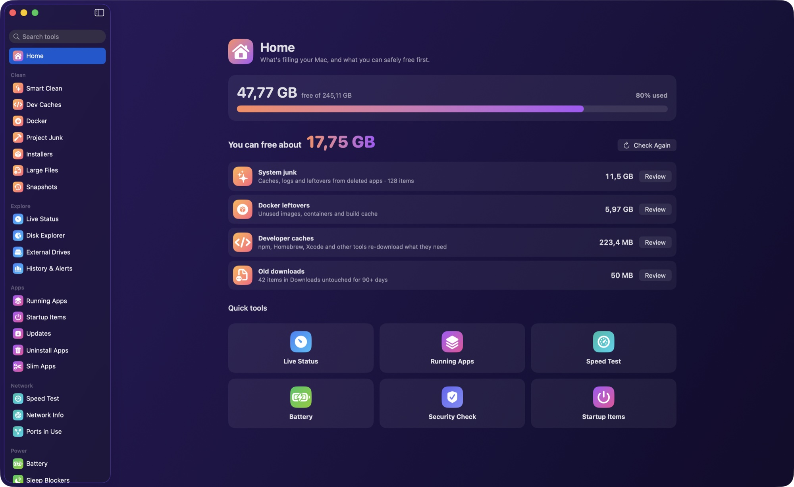
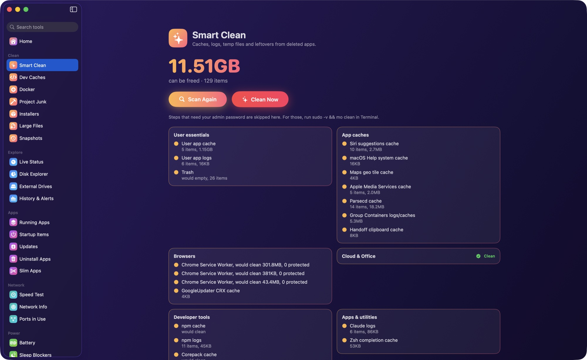
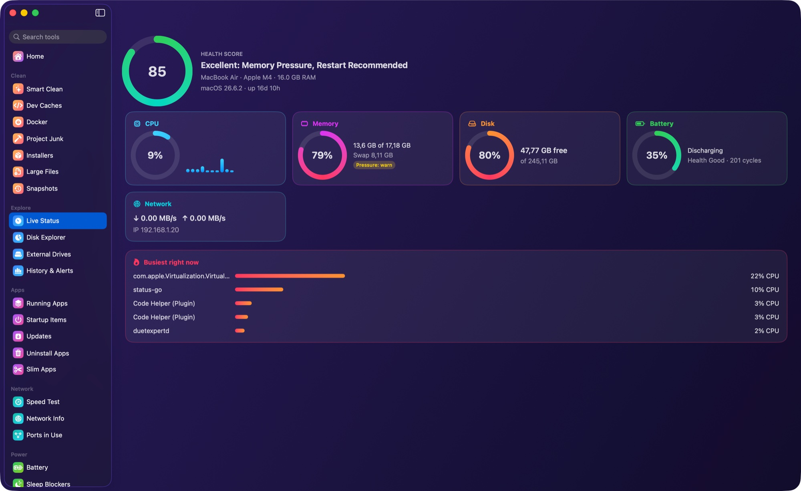
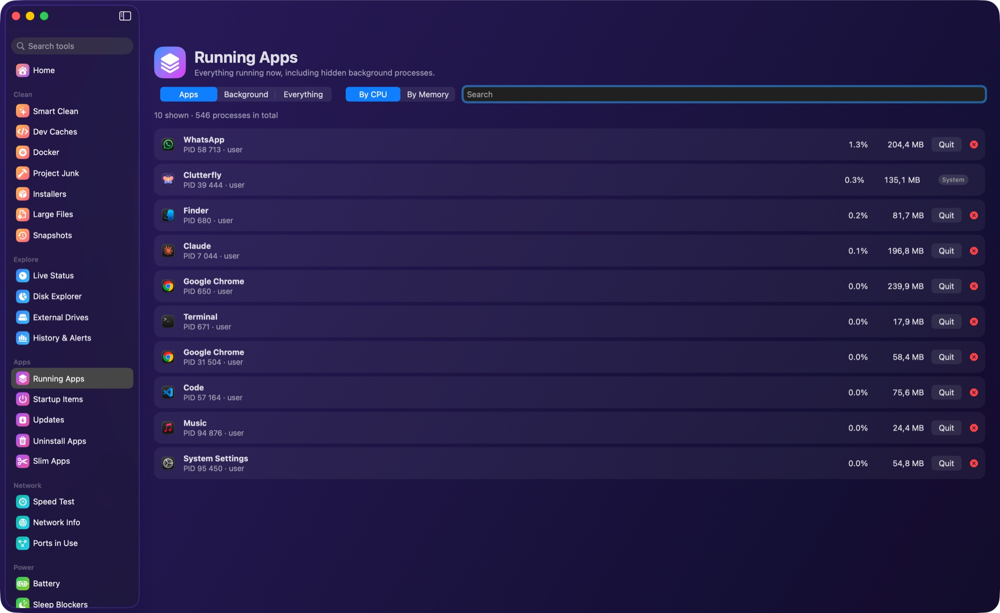
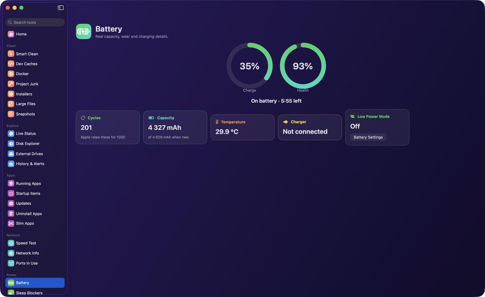

<div align="center">


# Clutterfly

**Let the clutter fly away.** Clean up your Mac and run 30+ handy Mac tools from one colorful app.

Clutterfly puts a friendly face on the excellent [Mole](https://github.com/tw93/Mole) cleaner and the Mac's own power tools that usually hide in Terminal.

[](https://github.com/rayhan999/clutterfly/releases/latest)


[](LICENSE)
[](https://github.com/rayhan999/clutterfly/stargazers)

[**⬇️ Download**](https://github.com/rayhan999/clutterfly/releases/latest) · [Features](#-features) · [Prerequisites](#-prerequisites) · [Install](#-install) · [Safety](#%EF%B8%8F-safe-by-design) · [Build](#-build-from-source) · [FAQ](#-faq)

<br>



</div>

---

## ✨ Why Clutterfly?

Your Mac fills up with caches, logs, old installers, dev junk and forgotten giant files. Tools to clean that up exist, but the good free ones live in Terminal, and the friendly ones cost money.

Clutterfly gives you both:

- 🧹 **See before you delete.** Every clean shows a preview first: what it found, where, and how big.
- 🎨 **Made for humans.** Plain words, big buttons, colorful screens, no commands to remember.
- 🧰 **One app, many jobs.** Cleaning, disk explorer, app uninstaller, running apps, startup items, ports, battery, network speed, security check and more.
- 🪶 **Tiny and native.** About 2 MB, pure SwiftUI, no Electron, no tracking, no account.
- 🔓 **Free and open source.** Read every line it runs.

## 📸 Screenshots

| Smart Clean | Live Status |
|---|---|
|  |  |
| **Running Apps** | **Battery** |
|  |  |

## 🚀 Features

Everything sits in a sidebar, grouped by what you want to do.

### 🧹 Clean
| | |
|---|---|
| **Smart Clean** | System and app caches, logs, browser junk and more, with a dry-run preview before anything is removed. |
| **Developer Caches** | npm, pnpm, Yarn, Bun, Homebrew, pip, Xcode DerivedData, Simulators, Gradle, Cargo, Go, CocoaPods. Sizes shown, cleaned with each tool's own command. |
| **Docker** | See what images, containers, volumes and build cache take, then prune with one click. |
| **Project Junk** | Finds `node_modules`, build folders and other leftovers in old projects. |
| **Old Installers** | `.dmg`, `.pkg` and `.zip` installers you forgot about. |
| **Large Files** | Files over 100 MB, 500 MB, 1 GB or 5 GB found instantly with Spotlight, plus Downloads older than 90 days. |
| **Time Machine Snapshots** | List and remove local snapshots that quietly hold space. |

### 🔭 Explore
| | |
|---|---|
| **Live Status** | Health score, CPU, memory, disk, network and top processes, updating every 2 seconds. |
| **Disk Explorer** | Drill into folders by size and move the big ones to the Trash. |
| **External Drives** | Explore, clean junk off and eject USB and external disks. |
| **History** | A chart of space freed over time, plus low-disk alerts from the menu bar. |

### 📦 Apps
| | |
|---|---|
| **Running Apps** | Every app *and* background process, sorted by CPU or memory, with Quit and Force Quit. |
| **Startup Items** | Everything that launches by itself, with on/off switches. |
| **Updates** | macOS updates and outdated Homebrew packages, with Upgrade All. |
| **Uninstall Apps** | Removes an app *and* the files it leaves behind. |
| **Slim Apps** | Finds apps carrying Intel code you no longer need. |

### 🌐 Network · 🔋 Power · 🛡️ System · 🛠️ Tools
| | |
|---|---|
| **Speed Test** | Download, upload, latency and responsiveness using Apple's own `networkQuality`. |
| **Network Info / Ports in Use** | Your IP, router and DNS; which apps are online; which apps listen on which ports, with Stop buttons. |
| **Battery** | Health, cycle count, capacity, temperature and charger wattage. |
| **Sleep Blockers / Caffeinate** | See who keeps your Mac awake, or keep it awake yourself with a timer. |
| **Security Check** | FileVault, Firewall, Gatekeeper and SIP at a glance (read-only). |
| **Disk First Aid** | Check your startup disk without Disk Utility. |
| **Quick Fixes** | Restart the Dock, Finder, menu bar or Wi-Fi; flush DNS; rebuild Spotlight. |
| **Tweaks** | Show hidden files, Dock auto-hide, screenshot folder and format, stop `.DS_Store` on USB drives, and more. |
| **Shortcuts** | Run your Shortcuts from big colorful buttons. |
| **Optimize, Protected Items, Touch ID for sudo, Update Mole** | Mole's maintenance tools, without Terminal. |

Plus a **menu bar item** with free space, a Keep Awake switch and quick scans.

## 📋 Prerequisites

### Required

| What | Why | How to get it |
|---|---|---|
| **macOS 14 Sonoma or later** | Clutterfly uses modern SwiftUI. | Apple menu → System Settings → General → Software Update |
| **Apple Silicon or Intel Mac** | The download is a universal app and runs natively on both. | — |
| **[Homebrew](https://brew.sh)** | Used to install and update Mole. | Clutterfly can open Terminal and install it for you, or run the command from [brew.sh](https://brew.sh). |
| **[Mole](https://github.com/tw93/Mole)** | Powers the Clean, Explore, Uninstall and Optimize tools. | Clutterfly offers a one-click install on first launch, or run `brew install mole`. |

### Recommended

| What | Why |
|---|---|
| **Full Disk Access** for Clutterfly | Without it, macOS asks for permission on every scan and some folders can't be read. Turn it on once in **System Settings → Privacy & Security → Full Disk Access**. The yellow banner in the app takes you there. |
| **An admin account** | Flush DNS, Rebuild Spotlight, deleting Time Machine snapshots and other system-wide jobs need your password. They open Terminal so you can type it yourself. |

### Optional (only for some screens)

| Screen | Needs |
|---|---|
| **Docker** | [Docker Desktop](https://www.docker.com/products/docker-desktop/) installed and running |
| **Developer Caches** | Only shows caches for tools you have (npm, Yarn, Xcode, Cargo and so on) |
| **Updates → Homebrew packages** | Homebrew (already needed for Mole) |
| **Shortcuts** | Shortcuts you've made in the Shortcuts app |
| **Battery** | A MacBook (desktop Macs have no battery to show) |

### To build from source

| What | How to get it |
|---|---|
| **Xcode Command Line Tools** (the full Xcode app isn't needed) | `xcode-select --install` |
| **Git** | Included with the Command Line Tools |

## 📥 Install

1. Download **Clutterfly.zip** from the [latest release](https://github.com/rayhan999/clutterfly/releases/latest).
2. Unzip it and drag **Clutterfly** into **Applications**.
3. **First launch:** Clutterfly isn't signed with a paid Apple developer account, so macOS says it can't verify it. Click **Done**, open **System Settings → Privacy & Security**, scroll down and click **Open Anyway**. You only do this once.
4. Follow the yellow banner in the app to give Clutterfly **Full Disk Access**, so it can scan everything without asking each time.
5. No Mole yet? Clutterfly offers to install it for you (`brew install mole`).

## 🛡️ Safe by design

- **Preview first.** Cleans run as a dry run before anything is deleted, and deletions ask for confirmation.
- **Trash, not gone.** Files you remove from the explorer and Large Files go to the Trash, so you can put them back.
- **Your apps' data is off-limits.** Clutterfly won't trash files inside app data folders, and warns you about iCloud and OneDrive files.
- **Only your own processes.** System processes can't be quit from Running Apps.
- **Passwords stay with you.** Anything that needs admin rights opens Terminal so *you* type your password. Clutterfly never sees it.
- **Protected Items.** Pick folders that cleaning must never touch.
- **Mole's safety checks stay on.** Clutterfly never bypasses them.

## 🔨 Build from source

All you need is Apple's free command-line tools (`xcode-select --install`), no Xcode project.

```sh
git clone https://github.com/rayhan999/clutterfly.git
cd clutterfly
./build.sh            # builds Clutterfly.app and installs it into /Applications
./build.sh release    # universal build (Apple Silicon + Intel) zipped as Clutterfly.zip
```

Apps you build yourself open without the "can't verify" warning. Run `./Clutterfly.app/Contents/MacOS/Clutterfly --selftest` to check every parser against live data from your Mac.

## ❓ FAQ

**macOS says Clutterfly "can't be verified" or "is damaged". Is it safe?**
The warning appears because the app isn't signed with a paid Apple developer account, not because anything is wrong with it. Use **Open Anyway** as described in [Install](#-install). If you'd rather check the code yourself, [build it from source](#-build-from-source); apps you build on your own Mac open without the warning.

**Full Disk Access keeps turning off.**
macOS ties that permission to the exact app copy. After installing a new version, turn it on again for Clutterfly.

**Do I need Mole for everything?**
No. Running Apps, Startup Items, Ports, Large Files, Speed Test, Network Info, Battery, Sleep Blockers, Caffeinate, Security Check, Disk First Aid, Quick Fixes, Tweaks and Shortcuts use tools built into macOS. The cleaning, explorer, uninstall and optimize screens need Mole.

**Why does uninstalling an app finish in Terminal?**
Mole asks for a final "yes" in Terminal before it removes an app. Clutterfly keeps that safety step rather than skipping it.

**Does Clutterfly collect any data?**
No. It has no analytics, no account and no network calls of its own. The only network activity is what you start yourself, like Speed Test or Updates.

## 🙏 Credits

Cleaning, optimizing and uninstalling are powered by [**Mole**](https://github.com/tw93/Mole) by [@tw93](https://github.com/tw93). Go give it a star too. Clutterfly is an independent project and isn't affiliated with Mole.

Clutterfly doesn't include any of Mole's code. It runs the `mo` command you install separately, the same way you would in Terminal. Mole is licensed under [GPL-3.0](https://github.com/tw93/Mole/blob/main/LICENSE).

## 📄 License

Clutterfly is released under the [MIT License](LICENSE).

---

<div align="center">

**If Clutterfly freed up some space for you, a ⭐ helps other Mac users find it.**

Ideas and bug reports are welcome in [Issues](https://github.com/rayhan999/clutterfly/issues).

</div>
